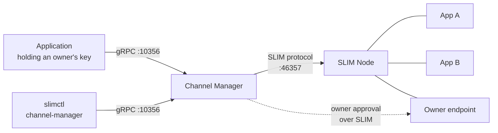

# SLIM Channel Manager

The SLIM Channel Manager is a standalone service that acts as the **moderator** for SLIM group channels. It connects to a SLIM data plane node as a regular application, creates and manages group sessions, and exposes a gRPC API so channels can be created and their membership changed without modifying application code.

## What the Channel Manager Does

Every SLIM group channel requires a moderator — the participant that controls membership. The Channel Manager takes that role on behalf of others:

- Connects to a SLIM node and registers itself as a named SLIM application
- Creates group sessions (channels) and invites participants to them
- Maintains the moderator role for the lifetime of each channel
- Exposes a gRPC management API on a configurable local port
- Verifies that each change is authorized by the channel's owner
- Optionally creates pre-configured channels and invites participants on startup

Because the Channel Manager is an independent service, application code never needs to implement moderation logic. Applications that hold a channel owner's key manage their own channels through the API, and administrators provision channels with `slimctl` as part of normal operations.

## Architecture



The Channel Manager sits between its callers and the SLIM data plane:

1. **Southbound** — connects to the SLIM data plane node as a SLIM application (gRPC or WebSocket transport, same as any other app)
2. **Northbound** — exposes a gRPC API (`ChannelManagerService`) that applications and `slimctl channel-manager` use to create channels and change their membership
3. **Owner approval** — a second SLIM application, `<local-name>-approval`, through which it asks a channel's owner to approve a change nobody holds a grant for

It holds the moderator role for every channel it creates: when a participant is added or removed, it performs the full SLIM group state update and MLS key rotation. What it does not hold is authority over those channels. A channel's owner is whoever signed its create request, identified by their key, and every change to an owned channel carries that owner's signature — which the Channel Manager verifies but cannot produce.

## Key Features

**Two management modes** — the Channel Manager operates in either config mode or API mode, mirroring the Controller's topology model. When channels are declared in the configuration file (config mode), the API refuses changes to them. When no channels are pre-configured (API mode), applications create channels and change their participants at any time through the gRPC API, with the channel owner's signature, without restarting the service.

**Channel ownership** — a channel created through the API is owned by whoever signed the create request. Participant changes need a grant from that owner, deletion needs their signed request, and the caller's authenticated identity never makes anyone an owner.

**Owner approval** — when a change is requested without a grant, the Channel Manager can ask the channel's owner over SLIM and wait for a signed answer, so an owner stays in the loop without having to anticipate every change.

**Expiry** — a channel can be created with a time to live, after which it and its MLS state are deleted automatically.

**MLS encryption** — channels are created with MLS end-to-end encryption enabled by default. Each membership change triggers a key rotation, so former members cannot read future messages and new members cannot read past messages. MLS can be disabled per channel if not required.

**Authentication** — the Channel Manager authenticates using the same options as any SLIM application: shared secret (development), JWT, or SPIRE (production).

## Managing Channels with slimctl

Applications holding a channel owner's key, such as SHADI, use the Channel Manager's gRPC API. Without one, the Channel Manager's administrator uses `slimctl channel-manager` (alias `cm`) with an Ed25519 key, which signs every change: see [Managing Channels with slimctl](./slimctl.md). The default API endpoint is `127.0.0.1:10356`.

```bash
# The admin key's did:key, to list in the config's operators
slimctl channel-manager did-key --key admin.pem

# Create a channel owned by the admin key (MLS enabled by default)
slimctl channel-manager create-channel agntcy/ns/team-chat --key admin.pem --audience agntcy/ns/channel-manager

# Invite and remove participants, with grants signed by the same key
slimctl channel-manager add-participant agntcy/ns/team-chat agntcy/ns/agent-1 --key admin.pem
slimctl channel-manager delete-participant agntcy/ns/team-chat agntcy/ns/agent-1 --key admin.pem

# List channels, with their owners and expiry times, and participants
slimctl channel-manager list-channels
slimctl channel-manager list-participants agntcy/ns/team-chat

# Delete the channel
slimctl channel-manager delete-channel agntcy/ns/team-chat --key admin.pem --audience agntcy/ns/channel-manager
```

Connect to a non-default endpoint with `--server`:

```bash
slimctl channel-manager --server 192.168.1.100:10356 list-channels
```

## In This Section

- [Concepts and Ownership](./ownership.md) — What the Channel Manager is and is not, config mode and API mode, owners, grants, operators and expiry, and the signed wire formats
- [Installation and Walkthrough](./install.md) — Build and run the Channel Manager, then create an owned channel, change its participants and delete it, with working code
- [Configuration Reference](./config.md) — All configuration options
- [Security Model](./security.md) — What each auth option identifies, and what authorizes a change
- [API Reference](./api.md) — Every RPC, message, error and the owner approval contract
- [Managing Channels with slimctl](./slimctl.md) — The administrator's guide
- [Deployment Guide](./deploy.md) — Containers, Kubernetes, identities, persistence and upgrades
- [Operations and Troubleshooting](./operations.md) — Logs, inspection and every error message

## Related

- [Groups](../../architecture/sessions/group.md) — The group communication model and the moderator role
- [Creating a Session](../sdk/tutorials/tutorial-session.md) — Create a group session and invite participants via the Channel Manager
- [Receiving a Session](../sdk/tutorials/tutorial-receive.md) — Listen for session invitations and receive messages
