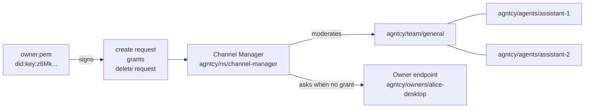

# Installation and Walkthrough

This page installs the Channel Manager, then builds one owned channel from nothing: a key, a channel that key owns, a participant added with a grant, a participant added through live owner approval, and finally a signed deletion. Every command and every signed statement is shown in full.

Read [Concepts and Ownership](./ownership.md) first if the words *owner*, *grant* and *operator* are not yet distinct.

## What you will build



## Prerequisites

- A running SLIM data plane node. The [data plane installation guide](../data-plane/install.md) covers this; the default endpoint used below is `http://127.0.0.1:46357`.
- `openssl`, to generate an Ed25519 key.

## Install the Channel Manager

The Channel Manager is available as a pre-built container image, or can be built from source.

### Docker

```bash
docker pull ghcr.io/agntcy/slim/channel-manager:2.0.0
docker run --rm -v ./config.yaml:/config.yaml ghcr.io/agntcy/slim/channel-manager:2.0.0 --config-file /config.yaml
```

The image is distroless and runs as a non-root user, with `/channel-manager` as its entrypoint. For containers and Kubernetes beyond this one command — bind addresses, secrets, volumes and the Helm chart — see the [Deployment Guide](./deploy.md). The steps below run the binary directly.

### Build from Source

Building needs the [Rust toolchain](https://rustup.rs/); the workspace pins a version through `rust-toolchain.toml`. Clone the repository if you have not already:

```bash
git clone https://github.com/agntcy/slim.git
cd slim
```

Build the Channel Manager binary in release mode:

```bash
cargo build --release -p agntcy-slim-channel-manager
```

This produces the `channel-manager` server binary in `target/release/`.

### Install slimctl

Every command below uses `slimctl channel-manager`, so install the CLI as well: see [SLIM CLI Installation](../cli/install.md).

## Step 1: Run a Channel Manager in API mode

API mode is what makes owned channels possible, and it is chosen by declaring no channels in the configuration file. Save this as `cm.yaml`; the [Configuration Reference](./config.md) documents every setting:

```yaml
channel-manager:
  slim-connection:
    endpoint: "http://127.0.0.1:46357"
    tls:
      insecure: true

  api-server:
    endpoint: "127.0.0.1:10356"
    tls:
      insecure: true

  local-name: "agntcy/ns/channel-manager"

  auth:
    type: shared_secret
    secret: ${env:SLIM_SHARED_SECRET}
```

The shared secret keeps this walkthrough short; it is not suitable beyond a development machine. [Deployment](./deploy.md#identities) covers SPIRE and did:key identities, and the configuration file supports `${env:...}` and `${file:...}` substitution everywhere, so no secret has to be written into it.

```bash
export SLIM_SHARED_SECRET='a-very-long-development-shared-secret-abcdef1234567890'
./target/release/channel-manager --config-file cm.yaml
```

`--config-file` defaults to `config.yaml` in the working directory, so a file named anything else has to be named on the command line.

A successful start logs the SLIM connection, the identity the Channel Manager registered as, what signed requests must name as their audience, and finally the API server's address:

```text
INFO Configuration loaded config_file=cm.yaml
INFO Connected to SLIM node endpoint=http://127.0.0.1:46357 conn_id=1
INFO SLIM app created local_name=agntcy/ns/channel-manager
INFO Sessions found in persistent storage count=0
INFO Signed create and delete requests must name this audience audience=agntcy/ns/channel-manager
INFO Starting gRPC server endpoint=127.0.0.1:10356
```

`count=0` is expected here: this configuration has no `persistence` section, so nothing survives a restart.

`Starting gRPC server` is the last line before the API accepts connections. [Operations](./operations.md#startup) explains the full startup sequence and the lines that appear only when the corresponding feature is configured.

One of those lines matters for the rest of this page: the `audience`. Every signed create and delete request below has to name it. It defaults to `local-name`; [`audience`](./config.md#audience) overrides it.

Confirm the API is answering:

```bash
slimctl channel-manager list-channels
```

```text
Channels (0):
```

`slimctl` talks to `127.0.0.1:10356` by default; `--server` points it somewhere else.

## Step 2: Generate the owner's key

A channel's owner is an Ed25519 key. Generate one and ask `slimctl` for its `did:key`, which is the identifier the Channel Manager will record as the owner:

```bash
openssl genpkey -algorithm ed25519 -out owner.pem
chmod 600 owner.pem
slimctl channel-manager did-key --key owner.pem
```

```text
did:key:z6MkneqwSGENkjKokLBYkhpY7B99mxrjVSLoECjsTR1z6iPU
```

A `did:key` carries its own public key, so nothing has to be registered anywhere: the Channel Manager can verify this key's signatures the first time it sees them. Keep `owner.pem` as you would any signing key — whoever holds it controls the channel.

## Step 3: Create an owned channel

The channel's owner is whoever signs its create request. `slimctl` signs with `--key` and sends in one step:

```bash
slimctl channel-manager create-channel agntcy/team/general \
  --key owner.pem \
  --audience agntcy/ns/channel-manager \
  --ttl-seconds 86400 \
  --owner-callback-name agntcy/owners/alice-desktop
```

```text
Channel agntcy/team/general created, owned by did:key:z6MkneqwSGENkjKokLBYkhpY7B99mxrjVSLoECjsTR1z6iPU
```

Three settings were chosen there, and all three are covered by the signature, so none can be altered in flight:

- MLS is on, because it is on unless `--disable-mls` says otherwise.
- `--ttl-seconds 86400` has the channel delete itself after a day, along with its MLS state.
- `--owner-callback-name` is where the owner can be asked to approve changes nobody holds a grant for. It requires a signed request: a channel with no owner has no one to ask.

Confirm what was recorded:

```bash
slimctl channel-manager list-channels
```

```text
Channels (1):
  - agntcy/team/general (owner: did:key:z6MkneqwSGENkjKokLBYkhpY7B99mxrjVSLoECjsTR1z6iPU, expires: 2026-10-14T08:00:00Z)
```

### Signing the create request in code

An application that holds an owner's key builds the same proof itself and puts it in `CreateChannelRequest.owner_proof`. The signature covers a domain tag and the request's fields, joined with NUL bytes; the full layout of each statement is in [Concepts and Ownership](./ownership.md#signed-formats).

=== "Rust"

    The channel-manager crate ships the signing side of its own verifier, so a Rust client does not reimplement the format:

    ```rust
    use agntcy_slim_channel_manager::grant::{ChannelCreation, SigningKey};

    let key = SigningKey::from_pkcs8_pem(&std::fs::read_to_string("owner.pem")?)?;

    let creation = ChannelCreation {
        audience: "agntcy/ns/channel-manager".to_string(),
        channel: "agntcy/team/general".to_string(),
        owner: key.did_key().to_string(),
        mls_enabled: true,
        ttl_seconds: Some(86_400),
        owner_callback_name: Some("agntcy/owners/alice-desktop".to_string()),
        not_after: unix_now() + 300,
        nonce: uuid::Uuid::new_v4().to_string(),
    };

    let request = CreateChannelRequest {
        channel_name: creation.channel.clone(),
        mls_enabled: creation.mls_enabled,
        ttl_seconds: creation.ttl_seconds,
        owner_callback_name: creation.owner_callback_name.clone(),
        owner_proof: Some(key.sign_create(&creation)?),
    };
    ```

    `sign_create` refuses a `ChannelCreation` whose `owner` is not the signing key's own `did:key`, because a signed create request names its signer.

=== "Python"

    No binding is needed to sign: the statements are JSON and Ed25519. This uses only the standard library and [`cryptography`](https://cryptography.io/).

    ```python
    import base64
    import json
    import time
    import uuid

    from cryptography.hazmat.primitives import serialization
    from cryptography.hazmat.primitives.asymmetric.ed25519 import Ed25519PrivateKey

    BASE58 = "123456789ABCDEFGHJKLMNPQRSTUVWXYZabcdefghijkmnopqrstuvwxyz"


    def base58btc(data: bytes) -> str:
        """Bitcoin-alphabet base58, as did:key's `z` multibase prefix denotes."""
        number = int.from_bytes(data, "big")
        encoded = ""
        while number > 0:
            number, remainder = divmod(number, 58)
            encoded = BASE58[remainder] + encoded
        leading_zeros = len(data) - len(data.lstrip(b"\x00"))
        return "1" * leading_zeros + encoded


    def did_key(public_key: bytes) -> str:
        """The did:key of an Ed25519 public key: multicodec 0xed01, then base58btc."""
        return "did:key:z" + base58btc(b"\xed\x01" + public_key)


    def load_owner_key(path: str) -> tuple[Ed25519PrivateKey, str]:
        """An Ed25519 key from a PKCS#8 PEM file, with its did:key."""
        with open(path, "rb") as pem:
            key = serialization.load_pem_private_key(pem.read(), password=None)
        if not isinstance(key, Ed25519PrivateKey):
            raise ValueError(f"{path} is not an Ed25519 key")
        public_key = key.public_key().public_bytes(
            serialization.Encoding.Raw, serialization.PublicFormat.Raw
        )
        return key, did_key(public_key)


    def sign(key: Ed25519PrivateKey, *fields: str) -> str:
        """Signs the NUL-joined fields, base64 as the Channel Manager expects."""
        return base64.b64encode(key.sign("\0".join(fields).encode())).decode()


    def signed_create(
        key: Ed25519PrivateKey,
        owner: str,
        audience: str,
        channel: str,
        mls_enabled: bool = True,
        ttl_seconds: int | None = None,
        owner_callback_name: str | None = None,
    ) -> bytes:
        """A signed create request: CreateChannelRequest.owner_proof."""
        not_after = int(time.time()) + 300
        nonce = str(uuid.uuid4())
        proof = {
            "audience": audience,
            "channel": channel,
            "owner": owner,
            "mls_enabled": mls_enabled,
            "not_after": not_after,
            "nonce": nonce,
            "signature": sign(
                key,
                "SLIM-CHANNEL-CREATE/1",
                audience,
                channel,
                owner,
                "true" if mls_enabled else "false",
                "" if ttl_seconds is None else str(ttl_seconds),
                owner_callback_name or "",
                str(not_after),
                nonce,
            ),
        }
        # An unset optional is omitted, and signs as the empty string.
        if ttl_seconds is not None:
            proof["ttl_seconds"] = ttl_seconds
        if owner_callback_name is not None:
            proof["owner_callback_name"] = owner_callback_name
        return json.dumps(proof).encode()
    ```

    With the stubs generated in [API Reference](./api.md#generating-client-stubs), the call itself is ordinary gRPC:

    ```python
    key, owner = load_owner_key("owner.pem")
    response = stub.CreateChannel(
        commands_pb2.CreateChannelRequest(
            channel_name="agntcy/team/general",
            mls_enabled=True,
            ttl_seconds=86400,
            owner_callback_name="agntcy/owners/alice-desktop",
            owner_proof=signed_create(
                key,
                owner,
                "agntcy/ns/channel-manager",
                "agntcy/team/general",
                ttl_seconds=86400,
                owner_callback_name="agntcy/owners/alice-desktop",
            ),
        )
    )
    if not response.success:
        raise RuntimeError(response.error_msg)
    ```

=== "Go"

    Standard library only:

    ```go
    package owner

    import (
        "crypto/ed25519"
        "crypto/rand"
        "crypto/x509"
        "encoding/base64"
        "encoding/hex"
        "encoding/json"
        "encoding/pem"
        "fmt"
        "math/big"
        "os"
        "strconv"
        "strings"
        "time"
    )

    const base58Alphabet = "123456789ABCDEFGHJKLMNPQRSTUVWXYZabcdefghijkmnopqrstuvwxyz"

    // base58btc is the bitcoin-alphabet base58 that did:key's "z" prefix denotes.
    func base58btc(data []byte) string {
        number := new(big.Int).SetBytes(data)
        radix, remainder := big.NewInt(58), new(big.Int)
        var encoded []byte
        for number.Sign() > 0 {
            number.DivMod(number, radix, remainder)
            encoded = append([]byte{base58Alphabet[remainder.Int64()]}, encoded...)
        }
        for _, b := range data {
            if b != 0 {
                break
            }
            encoded = append([]byte{'1'}, encoded...)
        }
        return string(encoded)
    }

    // didKey is the did:key of an Ed25519 public key: multicodec 0xed01, base58btc.
    func didKey(publicKey ed25519.PublicKey) string {
        return "did:key:z" + base58btc(append([]byte{0xed, 0x01}, publicKey...))
    }

    // LoadOwnerKey reads an Ed25519 key from a PKCS#8 PEM file, with its did:key.
    func LoadOwnerKey(path string) (ed25519.PrivateKey, string, error) {
        pemBytes, err := os.ReadFile(path)
        if err != nil {
            return nil, "", err
        }
        block, _ := pem.Decode(pemBytes)
        if block == nil {
            return nil, "", fmt.Errorf("%s holds no PEM block", path)
        }
        parsed, err := x509.ParsePKCS8PrivateKey(block.Bytes)
        if err != nil {
            return nil, "", err
        }
        key, ok := parsed.(ed25519.PrivateKey)
        if !ok {
            return nil, "", fmt.Errorf("%s is not an Ed25519 key", path)
        }
        return key, didKey(key.Public().(ed25519.PublicKey)), nil
    }

    // sign signs the NUL-joined fields, base64 as the Channel Manager expects.
    func sign(key ed25519.PrivateKey, fields ...string) string {
        message := []byte(strings.Join(fields, "\x00"))
        return base64.StdEncoding.EncodeToString(ed25519.Sign(key, message))
    }

    // newNonce is a value unique to one signed statement.
    func newNonce() string {
        raw := make([]byte, 16)
        if _, err := rand.Read(raw); err != nil {
            panic(err)
        }
        return hex.EncodeToString(raw)
    }

    // SignedCreate is CreateChannelRequest.owner_proof.
    type SignedCreate struct {
        Audience          string  `json:"audience"`
        Channel           string  `json:"channel"`
        Owner             string  `json:"owner"`
        MlsEnabled        bool    `json:"mls_enabled"`
        TTLSeconds        *uint64 `json:"ttl_seconds,omitempty"`
        OwnerCallbackName *string `json:"owner_callback_name,omitempty"`
        NotAfter          uint64  `json:"not_after"`
        Nonce             string  `json:"nonce"`
        Signature         string  `json:"signature"`
    }

    func NewSignedCreate(key ed25519.PrivateKey, owner, audience, channel string,
        mlsEnabled bool, ttlSeconds *uint64, ownerCallbackName *string) ([]byte, error) {
        // An unset optional signs as the empty string.
        ttl, callback := "", ""
        if ttlSeconds != nil {
            ttl = strconv.FormatUint(*ttlSeconds, 10)
        }
        if ownerCallbackName != nil {
            callback = *ownerCallbackName
        }
        mls := "false"
        if mlsEnabled {
            mls = "true"
        }
        proof := SignedCreate{
            Audience:          audience,
            Channel:           channel,
            Owner:             owner,
            MlsEnabled:        mlsEnabled,
            TTLSeconds:        ttlSeconds,
            OwnerCallbackName: ownerCallbackName,
            NotAfter:          uint64(time.Now().Add(5 * time.Minute).Unix()),
            Nonce:             newNonce(),
        }
        proof.Signature = sign(key,
            "SLIM-CHANNEL-CREATE/1",
            audience,
            channel,
            owner,
            mls,
            ttl,
            callback,
            strconv.FormatUint(proof.NotAfter, 10),
            proof.Nonce,
        )
        return json.Marshal(proof)
    }
    ```

!!! warning "Sign what you send"
    The Channel Manager compares the proof's `channel`, `mls_enabled`, `ttl_seconds` and `owner_callback_name` against the request's, and refuses the pair with `signed create request does not match this request` if any differ. Build the request from the same values that were signed, as above, rather than from two places.

## Step 4: Add a participant with a grant

Changes to an owned channel need the owner's signature too — the owner's own changes included. A **grant** is that signature for one participant change: this channel, this participant, this action, once.

With `slimctl`, `--key` signs the grant and sends the request together:

```bash
slimctl channel-manager add-participant \
  agntcy/team/general agntcy/agents/assistant-1 \
  --key owner.pem
```

```text
Participant agntcy/agents/assistant-1 added to channel agntcy/team/general
```

```bash
slimctl channel-manager list-participants agntcy/team/general
```

```text
Participants in channel agntcy/team/general (2):
  - agntcy/ns/channel-manager
  - agntcy/agents/assistant-1
```

The Channel Manager is in the list because it is the channel's moderator, and so a member of the group.

A grant does not have to be used by the owner. Because it authorizes exactly one change and nothing else, the owner can sign one and hand it to whoever needs to make that change:

=== "Rust"

    ```rust
    use agntcy_slim_channel_manager::grant::{Grant, GrantAction, SigningKey};

    let grant = key.sign_grant(&Grant {
        channel: "agntcy/team/general".to_string(),
        invitee: "agntcy/agents/assistant-2".to_string(),
        action: GrantAction::Add,
        role: "member".to_string(),
        not_after: unix_now() + 3600,
        nonce: uuid::Uuid::new_v4().to_string(),
    });
    // Hand `grant` to whoever will add the participant: it is useless for
    // anything else.
    ```

=== "Python"

    ```python
    def grant(
        key: Ed25519PrivateKey,
        channel: str,
        invitee: str,
        action: str,
        not_after: int,
    ) -> bytes:
        """A grant for one change: AddParticipantRequest.grant, or Delete's."""
        nonce = str(uuid.uuid4())
        return json.dumps(
            {
                "channel": channel,
                "invitee": invitee,
                "action": action,
                "role": "member",
                "not_after": not_after,
                "nonce": nonce,
                "signature": sign(
                    key,
                    "SLIM-CHANNEL-GRANT/1",
                    channel,
                    invitee,
                    action,
                    "member",
                    str(not_after),
                    nonce,
                ),
            }
        ).encode()
    ```

=== "Go"

    ```go
    // Grant authorizes one participant change.
    type Grant struct {
        Channel   string `json:"channel"`
        Invitee   string `json:"invitee"`
        Action    string `json:"action"`
        Role      string `json:"role"`
        NotAfter  uint64 `json:"not_after"`
        Nonce     string `json:"nonce"`
        Signature string `json:"signature"`
    }

    func NewGrant(key ed25519.PrivateKey, channel, invitee, action string, notAfter uint64) ([]byte, error) {
        g := Grant{
            Channel:  channel,
            Invitee:  invitee,
            Action:   action,
            Role:     "member",
            NotAfter: notAfter,
            Nonce:    newNonce(),
        }
        g.Signature = sign(key,
            "SLIM-CHANNEL-GRANT/1",
            channel,
            invitee,
            action,
            "member",
            strconv.FormatUint(g.NotAfter, 10),
            g.Nonce,
        )
        return json.Marshal(g)
    }
    ```

`action` is `"add"` for `AddParticipant` and `"delete"` for `DeleteParticipant`; `role` is carried in the grant but not enforced. Unlike signed create and delete requests, a grant's `not_after` is not capped at 24 hours, because the point of a grant is to be usable later.

Whoever received the grant sends it as the request's `grant` field, and needs no key of their own:

```bash
slimctl channel-manager add-participant \
  agntcy/team/general agntcy/agents/assistant-2 \
  --grant-file grant.json
```

Spend it twice and the second attempt fails with `grant has already been used`.

## Step 5: Answer approval requests as the owner

The channel was created with `--owner-callback-name agntcy/owners/alice-desktop`. That means a change requested with no grant is not refused outright: the Channel Manager asks the owner for one, over SLIM, and waits up to 60 seconds.

This path cannot be exercised with `slimctl`, which always signs or forwards something and so always presents a grant. It is for an application that calls `AddParticipant` with `grant` left unset — an orchestrator that knows who should join but holds no authority to admit them. The owner's endpoint is what decides.

An endpoint is a SLIM application that connects outbound — no inbound ports — subscribed to the callback name, with one handler registered for service `channel_manager.proto.v1.ChannelOwnerApproval`, method `RequestApproval`.

=== "Rust"

    The app must be `Direction::Bidirectional`: answering a call means both receiving and sending.

    ```rust
    use agntcy_slim_channel_manager::approval::{APPROVAL_METHOD, APPROVAL_SERVICE};
    use agntcy_slim_channel_manager::proto::approval_response::Decision;
    use agntcy_slim_channel_manager::grant::{Grant, GrantAction};
    use agntcy_slim_channel_manager::proto::{
        ApprovalRequest, ApprovalResponse, ParticipantAction,
    };
    use prost::Message;
    use slim_rpc::{Context, RpcError, Server};

    let server = Server::new_with_connection_and_runtime(
        app.clone(),
        app.app_name().clone(),
        Some(conn_id),
        notifications,
        None,
    );

    server.register_unary_unary(
        APPROVAL_SERVICE,
        APPROVAL_METHOD,
        move |bytes: Vec<u8>, ctx: Context| {
            let key = key.clone();
            async move {
                // Only the channel manager may ask. Check its verified
                // identity -- never the request's `requester` field, which
                // the request merely claims.
                if ctx.peer_subject().as_deref() != Some(CHANNEL_MANAGER_DID_KEY) {
                    return Err(RpcError::permission_denied("not the channel manager"));
                }

                let request = ApprovalRequest::decode(bytes.as_slice())
                    .map_err(|e| RpcError::invalid_argument(e.to_string()))?;
                let action = match request.action() {
                    ParticipantAction::Add => GrantAction::Add,
                    ParticipantAction::Delete => GrantAction::Delete,
                    ParticipantAction::Unspecified => {
                        return Err(RpcError::invalid_argument("no action"));
                    }
                };

                let decision = if allowed(&request) {
                    Decision::Grant(key.sign_grant(&Grant {
                        channel: request.channel_name.clone(),
                        invitee: request.participant_name.clone(),
                        action,
                        role: "member".to_string(),
                        not_after: unix_now() + 300,
                        nonce: uuid::Uuid::new_v4().to_string(),
                    }))
                } else {
                    Decision::Denied("not on the guest list".to_string())
                };

                Ok(ApprovalResponse { decision: Some(decision) }.encode_to_vec())
            }
        },
    );
    server.serve().await?;
    ```

=== "Python"

    `ChannelOwnerApproval` is deliberately not declared as a `service` in the proto — the Channel Manager is only ever its client — so there is no generated servicer to register. Use the raw handler API, which takes the service and method as strings. App and connection setup come from [Creating an Application](../sdk/tutorials/tutorial-app.md) and [Connecting](../sdk/tutorials/tutorial-connect.md).

    ```python
    import time

    import slim_bindings
    from channel_manager.v1 import commands_pb2

    CHANNEL_MANAGER_DID_KEY = "did:key:z6Mk..."  # logged as "Owner approval identity"

    ACTIONS = {
        commands_pb2.PARTICIPANT_ACTION_ADD: "add",
        commands_pb2.PARTICIPANT_ACTION_DELETE: "delete",
    }


    class ApprovalHandler(slim_bindings.UnaryUnaryHandler):
        def __init__(self, key, owner, allowed):
            self.key, self.owner, self.allowed = key, owner, allowed

        async def handle(self, request: bytes, context) -> bytes:
            # Only the channel manager may ask, as verified -- never the
            # request's `requester` field, which the request merely claims.
            if context.peer_subject() != CHANNEL_MANAGER_DID_KEY:
                raise PermissionError("not the channel manager")

            ask = commands_pb2.ApprovalRequest()
            ask.ParseFromString(request)
            action = ACTIONS.get(ask.action)
            if action is None:
                raise ValueError("no action")

            if ask.participant_name in self.allowed:
                answer = commands_pb2.ApprovalResponse(
                    grant=grant(
                        self.key,
                        ask.channel_name,
                        ask.participant_name,
                        action,
                        int(time.time()) + 300,
                    )
                )
            else:
                answer = commands_pb2.ApprovalResponse(denied="not on the guest list")
            return answer.SerializeToString()


    server = slim_bindings.Server.new_with_connection(app, local_name, conn_id)
    server.register_unary_unary(
        "channel_manager.proto.v1.ChannelOwnerApproval",
        "RequestApproval",
        ApprovalHandler(key, owner, {"agntcy/agents/assistant-3"}),
    )
    await server.serve_async()
    ```

=== "Go"

    ```go
    import (
        slim_rpc "github.com/agntcy/slim-bindings-go/v3/slim_rpc"
        pb "example.com/gen/channel-manager/v1"
        "google.golang.org/protobuf/proto"
    )

    // channelManagerDidKey is logged at startup as "Owner approval identity".
    const channelManagerDidKey = "did:key:z6Mk..."

    type approvalHandler struct {
        key     ed25519.PrivateKey
        allowed map[string]bool
    }

    func (h *approvalHandler) Handle(request []byte, context *slim_rpc.Context) ([]byte, error) {
        // Only the channel manager may ask, as verified -- never the
        // request's Requester field, which the request merely claims.
        subject := context.PeerSubject()
        if subject == nil || *subject != channelManagerDidKey {
            return nil, errors.New("not the channel manager")
        }

        var ask pb.ApprovalRequest
        if err := proto.Unmarshal(request, &ask); err != nil {
            return nil, err
        }
        var action string
        switch ask.GetAction() {
        case pb.ParticipantAction_PARTICIPANT_ACTION_ADD:
            action = "add"
        case pb.ParticipantAction_PARTICIPANT_ACTION_DELETE:
            action = "delete"
        default:
            return nil, errors.New("no action")
        }

        answer := &pb.ApprovalResponse{}
        if h.allowed[ask.GetParticipantName()] {
            grant, err := NewGrant(h.key, ask.GetChannelName(), ask.GetParticipantName(),
                action, uint64(time.Now().Add(5*time.Minute).Unix()))
            if err != nil {
                return nil, err
            }
            answer.Decision = &pb.ApprovalResponse_Grant{Grant: grant}
        } else {
            answer.Decision = &pb.ApprovalResponse_Denied{Denied: "not on the guest list"}
        }
        return proto.Marshal(answer)
    }

    server := slim_rpc.ServerNewWithConnection(app, localName, &connId)
    server.RegisterUnaryUnary(
        "channel_manager.proto.v1.ChannelOwnerApproval",
        "RequestApproval",
        &approvalHandler{key: key, allowed: map[string]bool{"agntcy/agents/assistant-3": true}},
    )
    server.ServeBlocking()
    ```

Three things about this handler are load-bearing:

**It authenticates the caller by the session's verified peer, not by the request.** `ApprovalRequest.requester` says who the Channel Manager believes asked — useful to show a human, worthless as authorization. The Channel Manager's own identity is the peer subject of the SLIM session.

**What that subject looks like depends on [`approval-auth`](./config.md#approval-auth).** Give the approval app a `jwt` identity and it is a stable `did:key`, logged at startup as `Owner approval identity` — the value to pin. With a shared secret it carries a per-instance suffix and cannot be pinned.

**A grant returned here is verified like any other.** It must name the channel, participant and action that were asked about; anything else fails with `grant does not authorize this change`. Returning `denied` instead propagates to the requester as `channel owner denied the request: not on the guest list`, and so does silence, after 60 seconds, as `channel owner did not answer the approval request in time`.

## Step 6: Delete the channel

Deleting an owned channel needs a delete request signed by its owner, or by an [operator](./config.md#operators). Like a create request, it names an `audience` and is valid for at most 24 hours.

```bash
slimctl channel-manager delete-channel agntcy/team/general \
  --key owner.pem \
  --audience agntcy/ns/channel-manager
```

```text
Channel agntcy/team/general deleted
```

=== "Rust"

    ```rust
    use agntcy_slim_channel_manager::grant::ChannelDeletion;

    let proof = key.sign_delete(&ChannelDeletion {
        audience: "agntcy/ns/channel-manager".to_string(),
        channel: "agntcy/team/general".to_string(),
        not_after: unix_now() + 300,
        nonce: uuid::Uuid::new_v4().to_string(),
    });
    ```

=== "Python"

    ```python
    def signed_delete(key: Ed25519PrivateKey, audience: str, channel: str) -> bytes:
        """A signed delete request: DeleteChannelRequest.owner_proof."""
        not_after = int(time.time()) + 300
        nonce = str(uuid.uuid4())
        return json.dumps(
            {
                "audience": audience,
                "channel": channel,
                "not_after": not_after,
                "nonce": nonce,
                "signature": sign(
                    key,
                    "SLIM-CHANNEL-DELETE/1",
                    audience,
                    channel,
                    str(not_after),
                    nonce,
                ),
            }
        ).encode()
    ```

=== "Go"

    ```go
    // SignedDelete is DeleteChannelRequest.owner_proof.
    type SignedDelete struct {
        Audience  string `json:"audience"`
        Channel   string `json:"channel"`
        NotAfter  uint64 `json:"not_after"`
        Nonce     string `json:"nonce"`
        Signature string `json:"signature"`
    }

    func NewSignedDelete(key ed25519.PrivateKey, audience, channel string) ([]byte, error) {
        d := SignedDelete{
            Audience: audience,
            Channel:  channel,
            NotAfter: uint64(time.Now().Add(5 * time.Minute).Unix()),
            Nonce:    newNonce(),
        }
        d.Signature = sign(key,
            "SLIM-CHANNEL-DELETE/1",
            audience,
            channel,
            strconv.FormatUint(d.NotAfter, 10),
            d.Nonce,
        )
        return json.Marshal(d)
    }
    ```

A signed delete request carries no owner field: the Channel Manager verifies it against the channel's owner first, then against each configured operator, which is how an operator deletes a channel whose owner's key is gone.

Had the channel not been deleted here, its `--ttl-seconds 86400` would have deleted it within about 30 seconds of a day passing, with no signature from anyone.

## Step 7: Require signatures

Everything above was signed, but nothing so far *required* it: a client could still have created a channel with no owner, and such a channel accepts changes from anyone who can reach the API. Once every client signs its creates, close that door in the configuration:

```yaml
channel-manager:
  require-signatures: true
  operators:
    - "did:key:z6Mk..."   # printed by: slimctl channel-manager did-key --key operator.pem
```

The Channel Manager now refuses unsigned creates and refuses every change to a channel with no owner — including channels created before the setting was turned on, which only an operator can now delete. Run `list-channels` before turning it on to see which channels those are, and read [require-signatures](./security.md#require-signatures) for the migration.

## Next steps

- [Concepts and Ownership](./ownership.md) — Config mode and API mode, owners, grants, operators and the signed formats
- [Configuration Reference](./config.md) — The SLIM connection, the API server, authentication, ownership settings and startup channels
- [API Reference](./api.md) — Every field and every error of the calls used here
- [Security Model](./security.md) — Why each check exists, and what it does not cover
- [Managing Channels with slimctl](./slimctl.md) — The administrator's path, without an application
- [Deployment Guide](./deploy.md) — Identities, persistence and `audience` for a real deployment
- [Operations and Troubleshooting](./operations.md) — What the logs say, and what each refusal means
