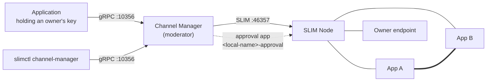
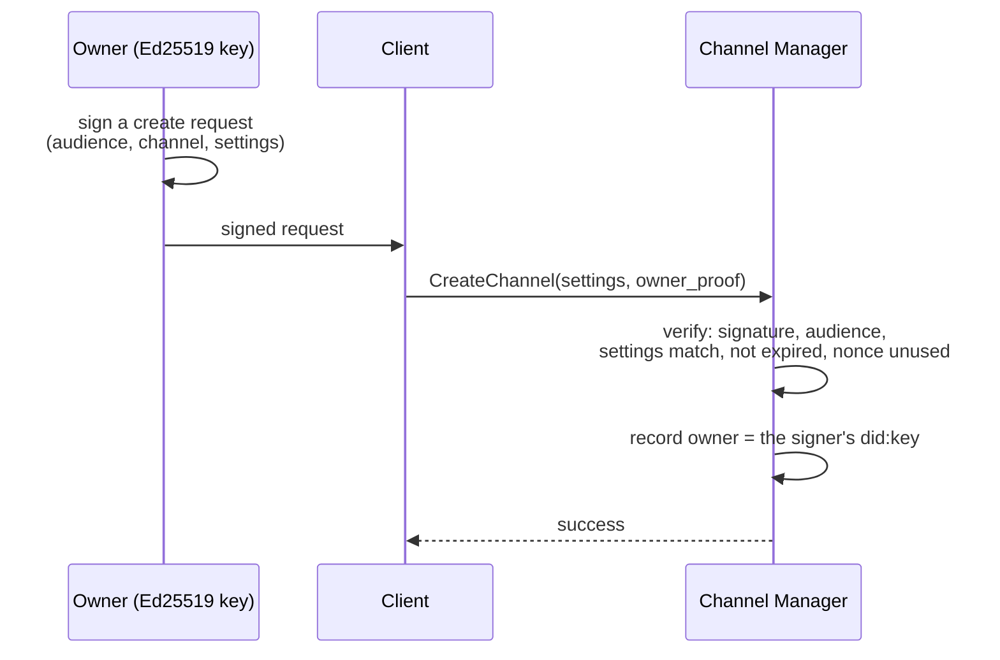
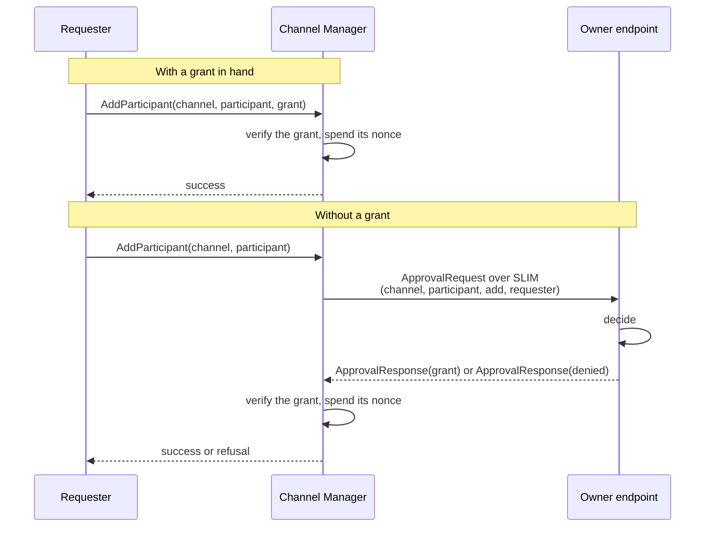
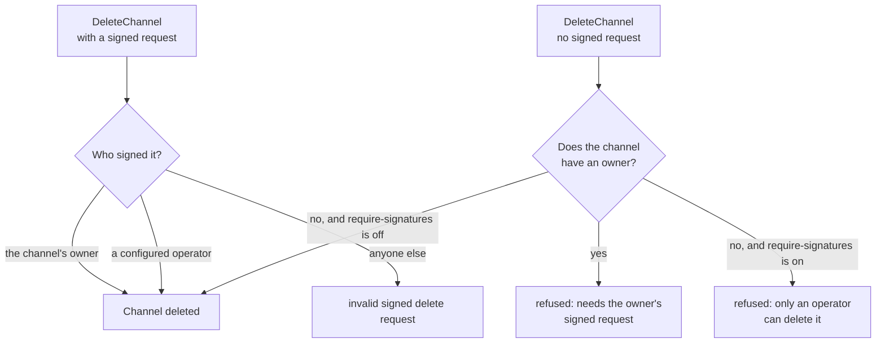

# Concepts and Ownership

This page explains the model the Channel Manager implements — what it does for a group channel, who is allowed to change one, and how grants, owner approval, operators and expiry fit together — and then documents the exact wire format of every signed statement.

Ownership and expiry apply to channels created through the API. Channels declared in the configuration file have neither, and cannot be changed at runtime at all.

The [walkthrough](./install.md) puts this model to work with running code, and [Security Model](./security.md) covers what each mechanism protects against.

## What the Channel Manager is

Every SLIM group channel has exactly one **moderator**: the participant that invites and removes members, and that drives the MLS key rotation each change requires. The Channel Manager is a service that holds this role on behalf of others. It connects to a SLIM node as an ordinary SLIM application, creates group sessions, and exposes a gRPC API through which channels and their membership are managed.

It has two faces:

- **Southbound**, it is a SLIM application like any other. It connects to a data plane node over gRPC or WebSocket, authenticates with a shared secret, a JWT identity or SPIRE, and registers under its `local-name`.
- **Northbound**, it serves `ChannelManagerService` on a local gRPC port. Applications that hold a channel owner's key call it directly; an administrator calls it with [`slimctl channel-manager`](./slimctl.md).

A third, smaller face exists for [owner approval](#owner-approval): a separate SLIM application named `<local-name>-approval`, which the Channel Manager uses to call channel owners back over SLIM.



The dashed line is the approval app; the double line between App A and App B is channel traffic, which the Channel Manager never carries.

## What the Channel Manager is not

**It is not a message relay.** Messages published to a channel travel through the SLIM data plane to the channel's members. The Channel Manager is a member of each channel it moderates, but application payloads are not routed through it, and it does not read them: the channel's MLS group keys are negotiated among the members.

**It is not an authorization server for applications.** It decides exactly one thing: whether a change to a channel it moderates is authorized. It issues no tokens and answers no policy questions for anyone else.

**It is not a replicated service.** Ownership, expiry times and spent grant nonces live in one process and, with [persistence](./config.md#persistence) configured, one state directory. Run a single replica per state directory; see [Deployment](./deploy.md#why-a-single-replica).

**It is not the owner of the channels it moderates.** Holding the moderator role is a mechanical job. Who may change a channel is decided by signatures, which the Channel Manager verifies but cannot produce.

## Config mode and API mode

Which mode the Channel Manager runs in is decided at startup by whether the configuration file declares any channels:

| | Config mode | API mode |
|---|---|---|
| Chosen when | `channels:` is non-empty | `channels:` is absent or empty |
| Channels come from | the configuration file | `CreateChannel` calls |
| `CreateChannel`, `DeleteChannel`, `AddParticipant`, `DeleteParticipant` | refused | served |
| `ListChannels`, `ListParticipants` | served | served |
| Owners | none | whoever signs the create request |
| Expiry | none | optional, per channel |

In **config mode** the file is the single source of truth. At startup the Channel Manager creates each declared channel, invites its declared participants, and — if the channels were restored from persistent storage — reconciles the roster against the file, removing participants no longer listed and inviting those not yet in the session. Channels in storage that the file no longer declares are deleted. Every mutating RPC then fails with `channel manager is running in config mode; modify the config file and restart to change channels or participants`. Change the file and restart to change anything.

In **API mode** channels are created at runtime, each with the owner, the time to live and the approval callback its create request asks for. This is the mode the rest of this page describes.

The two do not mix: a Channel Manager with configured channels serves no mutating calls at all, not even for channels that are not in the file.

## Who owns a channel

A channel's **owner** is whoever signed the request that created it, identified by the key they signed with. With the default verifier that identity is a `did:key` encoding an Ed25519 public key, which carries its own public key and so needs no registry to resolve. The signed request travels in `CreateChannelRequest.owner_proof`, and has to cover the exact settings the channel is created with.

**Authenticating to the API does not make anyone an owner.** The API server's authentication — a token's `sub` claim, or the SPIFFE ID in a client certificate — says which user or workload opened the connection. That is a useful thing to log, and the Channel Manager passes it to owners as the `requester` of an approval, but it is not a key, so nothing can be signed with it later. Treating it as ownership would mean that anyone who can authenticate to the API could change any channel they created, with no way for the channel's real owner to delegate, revoke or prove anything.

So ownership comes from a signature, and only from a signature:



A channel created **without** a signed request has no owner. Nothing then gates changes to it: anyone who can reach the API can add participants, remove them or delete the channel. That is the behaviour of releases before ownership existed, kept so clients can adopt signed requests gradually, and it is exactly what [`require-signatures`](#requiring-signatures) turns off.

`slimctl channel-manager list-channels` shows each channel's owner, or no owner at all.

### Channels owned by a login identity

Earlier versions recorded the creator's authenticated identity as the owner. Such a channel keeps that owner, but no signature can be checked against an OIDC subject or a SPIFFE ID, so its participants can no longer be changed. An [operator](#operators) can delete it, and it still expires if it was created with a time to live.

## Changing an owned channel

Every change to an owned channel needs the owner's signature — including changes the owner makes themselves. There is no implicit "the owner is calling, so it is fine": the Channel Manager has no way to tell the owner apart from anyone else on a gRPC connection, because the connection's identity is not the owner's key.

There are three kinds of signed statement, each with its own domain tag so one can never be replayed as another:

| Statement | Authorizes | Carried in |
|---|---|---|
| Signed create request | creating this channel, with these exact settings, and becoming its owner | `CreateChannelRequest.owner_proof` |
| Grant | one participant change: this channel, this participant, this action | `AddParticipantRequest.grant`, `DeleteParticipantRequest.grant` |
| Signed delete request | deleting this channel | `DeleteChannelRequest.owner_proof` |

Their exact wire formats are [below](#signed-formats). None may be expired, and each is accepted only once. On a channel with no owner, participants are added and removed, and the channel deleted, without any of them — unless [`require-signatures`](#requiring-signatures) is set, which forbids changing such a channel at all.

### Grants

A grant is a statement, signed by the owner, that authorizes one specific change: it names the channel, the participant, and whether that participant is being added or removed. A grant to add someone cannot be spent removing them. A grant for one channel is worthless against another. Each grant is accepted once, and only until its `not_after` passes.

This makes a grant safe to hand out. An owner can sign a grant for a participant and let that participant, or an orchestrator, present it to the Channel Manager; whoever carries the grant gains the ability to make that one change, and nothing more.

### Owner approval

A grant has to exist before the change is requested. When a change is requested with no grant, the Channel Manager can ask the owner for one, there and then — if the channel was created with an `owner_callback_name`, a SLIM name at which the owner's endpoint listens.

The Channel Manager sends an `ApprovalRequest` to that name over SLIM, naming the channel, the participant, the action, and the verified identity of whoever asked. The owner's endpoint answers with either a grant or a denial. A grant that comes back this way is verified exactly like one presented on the original request — the live answer is a shortcut for delivering a grant, not a way around verifying it.

Anything other than a signed grant is a refusal: an explicit denial, an endpoint that cannot be reached, a malformed answer, and no answer within 60 seconds all deny the change. An unreachable owner is never a yes.



Without a callback name, a request with no grant is refused outright: `channel <name> requires a grant from its owner`.

The call itself is SlimRPC: service `channel_manager.proto.v1.ChannelOwnerApproval`, method `RequestApproval`, with `ApprovalRequest` and `ApprovalResponse` defined in the Channel Manager's protobuf definitions. It comes from the SLIM name `<local-name>-approval`, which the Channel Manager registers with the credentials in [`approval-auth`](./config.md#approval-auth) if set, and otherwise with the same credentials as its `local-name`. With a `jwt` `approval-auth`, owner endpoints can recognize the Channel Manager by its did:key even when it connects to SLIM as a SPIRE workload; it logs that did:key at startup as its owner approval identity.

An owner endpoint should accept a request only from the Channel Manager, checked by its verified identity rather than by the sender's name or the request's `requester` field. In a SlimRPC handler that is `ctx.peer_subject()`, available in Rust and in the bindings alike: the subject of the identity token the Channel Manager's approval app set up the session with. (`ctx.session().peer_identity()` gives the whole identity, in Rust only.) It is set only for sessions using MLS, which SlimRPC calls do.

Because the owner's endpoint connects to SLIM outbound, it needs no inbound ports.

### Operators

An **operator** is a `did:key` listed in the Channel Manager's [`operators`](./config.md#operators) configuration. An operator's signed delete request — the same format as an owner's, sent the same way — deletes any channel: one whose owner's key was lost, one owned by a login identity that can no longer sign, or one with no owner at all.

Operators are deliberately narrow. They cannot add or remove participants, and they do not own anything. An operator is the answer to "this channel has to go and its owner cannot authorize that", and nothing else.



### Expiry

A channel created with a `ttl_seconds` is deleted automatically once that many seconds have passed, together with its sessions' MLS state. A reaper checks every 30 seconds, so a channel can outlive its time to live by up to that long, and `list-channels` may briefly still show it. The first check runs at startup, which deletes channels whose time to live passed while the Channel Manager was down.

Expiry needs no signature from anyone: the owner asked for it when they created the channel. `list-channels` shows when each channel expires.

## Requiring signatures

By default a channel can still be created without a signature, and then has no owner, so existing clients keep working while they move to signed requests. With [`require-signatures`](./config.md#require-signatures) set, the Channel Manager refuses an unsigned create, and refuses every change to a channel that has no owner, such as one created before it was set. Only an operator can delete such a channel.

## Clients

Applications that hold an owner's key, such as SHADI, call the Channel Manager's gRPC API directly. Without such an application, the Channel Manager's admin manages channels with [`slimctl channel-manager`](../cli/reference/channel-manager/index.md) and an Ed25519 key:

- `--key` signs each change with the key: a create request, which makes the key's did:key the channel's owner, a grant, or a delete request. `--audience` names the Channel Manager that create and delete requests are for.
- `--signed-request-file` and `--grant-file` forward a request or grant signed elsewhere instead.
- `slimctl channel-manager did-key --key` prints a key's did:key, for example to list it in `operators`.

slimctl never sends an unsigned change: it acts on the key holder's authority, never its own.

## Signed formats

The default verifier expects an owner to be a `did:key` encoding an Ed25519 public key. Every signed statement is a JSON document whose `signature` is the standard, padded base64 encoding of an Ed25519 signature over its signed bytes: the UTF-8 bytes of a literal tag, then the fields listed, in that order, joined with a NUL byte, with no trailing NUL. Numbers are in decimal. `not_after` is in Unix seconds. `nonce` must be unique per statement. No field may contain a NUL byte.

### Grant

A grant is this JSON document:

```json
{
  "channel": "agntcy/team/general",
  "invitee": "agntcy/agents/assistant-1",
  "action": "add",
  "role": "member",
  "not_after": 1767225600,
  "nonce": "4f9c2e7a1b",
  "signature": "<base64>"
}
```

Signed bytes: `SLIM-CHANNEL-GRANT/1`, `channel`, `invitee`, `action`, `role`, `not_after`, `nonce`. `action` is `add` for `AddParticipant` and `delete` for `DeleteParticipant`, and must match the request the grant is used for. `role` is carried but not enforced.

### Create request

A signed create request names its signer as `owner`, and the Channel Manager it is meant for as `audience`:

```json
{
  "audience": "agntcy/prod/channel-manager",
  "channel": "agntcy/team/general",
  "owner": "did:key:z6Mk...",
  "mls_enabled": true,
  "ttl_seconds": 86400,
  "owner_callback_name": "agntcy/owners/alice-desktop",
  "not_after": 1767225600,
  "nonce": "b81d4f0c9e",
  "signature": "<base64>"
}
```

Signed bytes: `SLIM-CHANNEL-CREATE/1`, `audience`, `channel`, `owner`, `mls_enabled` (`true` or `false`), `ttl_seconds`, `owner_callback_name`, `not_after`, `nonce`.

`ttl_seconds` and `owner_callback_name` are optional. When unset, omit them from the JSON, and sign each as the empty string. A present but empty `owner_callback_name` is rejected outright rather than treated as absent, because an empty name signs exactly the same bytes as no name at all and the two would otherwise be indistinguishable. The signature is checked with the key in `owner`, and `channel`, `mls_enabled`, `ttl_seconds` and `owner_callback_name` must equal the request's settings.

`audience` is the Channel Manager's [`audience`](./config.md#audience), its `local-name` by default, so a request signed for one Channel Manager is refused by another. `not_after` may be at most 24 hours ahead.

### Delete request

```json
{
  "audience": "agntcy/prod/channel-manager",
  "channel": "agntcy/team/general",
  "not_after": 1767225600,
  "nonce": "07a3e5d2f1",
  "signature": "<base64>"
}
```

Signed bytes: `SLIM-CHANNEL-DELETE/1`, `audience`, `channel`, `not_after`, `nonce`. The signature is checked against the channel's owner, then against each operator. As for a create request, `audience` must name this Channel Manager and `not_after` may be at most 24 hours ahead.

### Other verifiers

Deployments embedding the Channel Manager can plug in a different verifier for other formats or key schemes, for example one that resolves an agent's binding certificate to its human owner.

## Restarts and replicas

With [persistence](./config.md#persistence) configured, owners, expiry times and already-used grants survive a restart along with the channels. Run a single Channel Manager replica per state directory: replicas don't share this state.

## Vocabulary

| Term | Meaning |
|---|---|
| Channel | A SLIM group session the Channel Manager moderates, named `org/namespace/channel`. |
| Moderator | The participant that invites and removes members and drives MLS key rotation. Always the Channel Manager, for the channels it creates. |
| Owner | The key that signed a channel's create request. Authorizes every change to the channel. |
| Operator | A `did:key` in the configuration whose signed delete request deletes any channel. Cannot change participants. |
| Grant | A statement signed by the owner authorizing one participant change. Single-use, expiring. |
| Signed request | A statement signed by an owner or operator authorizing a create or a delete. Single-use, expiring, capped at 24 hours. |
| Audience | What a signed create or delete request must name as the Channel Manager it is for. Defaults to `local-name`. |
| Callback name | The SLIM name at which a channel's owner can be asked to approve a change. Set at creation. |
| Approval app | The `<local-name>-approval` SLIM application the Channel Manager sends approval requests from. |
| Nonce | A value unique to each signed statement, remembered once spent so the statement cannot be replayed. |
| Requester | The verified identity of whoever asked for a change, as reported to the owner in an approval request. |

## Related

- [Installation and Walkthrough](./install.md) — Create, change and delete an owned channel end to end, with working code
- [Security Model](./security.md) — Replay protection, operators and `require-signatures`
- [API Reference](./api.md) — Every RPC, message and error, and the RPCs these statements are carried in
- [Configuration Reference](./config.md) — Every setting named on this page
- [Managing Channels with slimctl](./slimctl.md) — Signing and forwarding statements from the command line
- [Groups](../../architecture/sessions/group.md) — The group communication model and the moderator role
